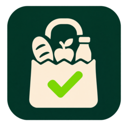

# ВкусВилл для Home Assistant

Интеграция сообщества для отслеживания заказов ВкусВилла. Показывает номер выбранного заказа, исходный статус из официального MCP API, дату последнего заказа и время успешного опроса. Доступ запрашивается только на чтение истории покупок и продление входа.

<!-- ha-marketplace:exclude-start -->
<p></p>

[](https://my.home-assistant.io/redirect/marketplace_repository/?owner=inok546&repository=ha-vkusvill&category=integration)
[](https://github.com/inok546/ha-vkusvill/actions/workflows/checks.yml)

## Установка

**Marketplace, Home Assistant 2026.11 и новее.** Откройте **Настройки → Marketplace → Добавить по ссылке** и введите `https://github.com/inok546/ha-vkusvill` или воспользуйтесь кнопкой выше. Для добавления по ссылке потребуется подключение GitHub. Откройте карточку **ВкусВилл**, установите интеграцию и перезапустите Home Assistant, если он попросит. [Документация Marketplace](https://www.home-assistant.io/integrations/marketplace/#custom-repositories).

<details>
<summary>Установка через HACS или вручную</summary>

- **HACS на Core 2026.10.4.** Добавьте `https://github.com/inok546/ha-vkusvill` как пользовательский репозиторий с категорией «Интеграция». Установите ВкусВилл и перезапустите Home Assistant.
- **Вручную.** Скопируйте папку `custom_components/vkusvill/` из [релиза](https://github.com/inok546/ha-vkusvill/releases/latest) целиком в `/config/custom_components/vkusvill/` на HAOS и перезапустите Home Assistant.

</details>
<!-- ha-marketplace:exclude-end -->

## Настройка и вход

Нужен доступ Home Assistant по HTTPS к `mcp.vkusvill.ru` и `oauth.vkusvill.ru`. Минимальная версия Home Assistant Core — 2026.10.4.

**Статус проверки.** Пользователь подтвердил ручной OAuth и чтение истории на реальном аккаунте. На заказе наблюдалась последовательность `Сборка` → `Готов` → `Доставка` → `Успешно завершен`. Открыты проверки статуса отмены, автоматического обновления токенов и callback My Home Assistant. [Результаты проверки API](docs/API_FINDINGS.md).

1. Создайте **отдельного персонального OAuth-клиента** для Home Assistant. В форме ВкусВилла выберите «У моего сервиса нет публичного URI» и проверьте, что адрес возврата клиента в точности `http://localhost:3000/callback`. Разрешите «История покупок» (`purchase_history.read`) и «Продление входа» (`offline_access`). ВкусВилл отправит идентификатор и секрет клиента на почту. [Регистрация клиента](https://vkusvill.ru/oauth/registration/).
2. Откройте **Настройки → Устройства и службы → Добавить интеграцию → ВкусВилл**. Введите идентификатор и секрет клиента. Откройте предложенную ссылку и в течение пяти минут подтвердите доступ на сайте ВкусВилла.
3. Когда браузер перейдёт на `http://localhost:3000/callback`, скопируйте **полный адрес** из адресной строки, включая `code` и `state`, и вставьте в форму интеграции. Ошибка соединения на локальной странице ожидаема. `localhost` здесь означает компьютер с браузером. Для этого шага используйте доверенный компьютер без приложения, слушающего порт 3000. После вставки закройте вкладку. Ссылку возврата и секрет вводите только в интерфейс своего HA.
4. Home Assistant проверит полученный доступ запросом к истории заказов и создаст сущности. В параметрах интеграции можно выбрать интервал от 60 до 3600 секунд. По умолчанию 120 секунд.

Поддерживается одна запись интеграции на экземпляр HA. Для входа требуется refresh token. Если форма ВкусВилла выдаёт другой callback или сервер отклоняет запрошенные права, завершение настройки зависит от регистрации подходящего OAuth-клиента у ВкусВилла. HAOS не требуется отдельный сервер для callback, контейнер, Node.js, CLI, cron или правка `configuration.yaml`.

## Сущности

Идентификаторы при первой установке приведены ниже. Если ID уже занят или изменён, сверьте его в реестре сущностей HA.

| Сущность | Состояние |
| --- | --- |
| `sensor.vkusvill_order_status` | Текст `status_name` выбранной записи. Атрибуты содержат время заказа, если оно распознано, время успешного опроса и нормализованную стадию. |
| `sensor.vkusvill_order_card_status` | Текст для карточки активного заказа и подтверждённого завершения в пределах 60 минут. |
| `sensor.vkusvill_order_stage` | Нормализованная стадия. Незнакомые статусы отображаются как `unknown`. |
| `sensor.vkusvill_order_id` | Номер выбранной записи из истории. |
| `sensor.vkusvill_active_order_id` | Номер подтверждённо активного заказа, если он есть. |
| `binary_sensor.vkusvill_active_order` | Есть подтверждённо активный заказ. `off`, когда получена полная непустая история и все её записи подтверждённо завершены. |
| `binary_sensor.vkusvill_courier` | Стадия `Доставка` у выбранного активного заказа. |
| `sensor.vkusvill_last_order_created_at` | Дата и время создания самой свежей записи среди полученных заказов с распознанным `created_at`. Учитываются все страницы текущего опроса. |
| `sensor.vkusvill_last_successful_update` | Время получения последнего успешного ответа. |

Интеграция предпочитает самый свежий подтверждённо активный заказ. Если активный заказ не распознан, она показывает самую свежую запись истории по `created_at`. При равенстве времени используется ключ заказа, затем текст статуса. Если дата отсутствует, запись уступает записи с датой. История ограничена последними 30 днями. За один опрос клиент читает до восьми страниц, учитывает `has_more` и пропускает дубликаты. При отсутствии `has_more` короткая страница считается последней.

Успешная пустая история оставляет поля заказа в `unknown`, а время успешного ответа обновляется. Ошибка API переводит сущности в `unavailable`. Исчезновение записи и смена выбранного заказа сами по себе ничего не говорят о доставке.

Дата последнего заказа рассчитывается по истории независимо от того, какой заказ выбран для отображения статуса. При успешном опросе без записей с распознанным временем этот датчик показывает `unknown`.

### Карточка с текстом статуса

В режиме редактирования панели добавьте карточку вручную и вставьте этот YAML. `sensor.vkusvill_order_card_status` создаёт сама интеграция.

```yaml
type: conditional
conditions:
  - condition: state
    entity: sensor.vkusvill_order_card_status
    state_not: ["unknown", "unavailable"]
card:
  type: markdown
  text_only: true
  content: "{{ states('sensor.vkusvill_order_card_status') | e }}"
```

Карточка показывает текст самого свежего подтверждённо активного заказа. Если интеграция увидела, что ранее активный заказ доставлен или отменён, текст этого заказа остаётся виден 60 минут с первого успешного опроса, обнаружившего этот переход. Новый активный заказ получает приоритет. Таймер отсчитывается по времени наблюдения в HA. Старый завершённый заказ, увиденный впервые, и исчезновение записи из истории таймер не запускают. После перезапуска остаток времени восстановится, если MCP снова вернёт тот же заказ с подтверждённым конечным статусом.

С версии 0.3.1 карточка появляется на статусах `Сборка`, `Готов` и `Доставка`. После перехода на `Успешно завершен` начинается отсчёт. Точное значение статуса отмены ещё проверяется. Во время сбоя API или при необходимости повторного входа карточка скрывается. [Чеклист наблюдений](docs/INTEGRATION_CHECKLIST.md).

### Автоматизация по смене текста статуса

Пример создаёт уведомление, если изменился текст статуса выбранной записи. Смена выбранной записи также может изменить текст.

```yaml
alias: ВкусВилл — изменился статус заказа
triggers:
  - trigger: state
    entity_id: sensor.vkusvill_order_status
    not_from:
      - unknown
      - unavailable
    not_to:
      - unknown
      - unavailable
actions:
  - action: persistent_notification.create
    data:
      title: ВкусВилл
      message: "Статус заказа изменился: {{ trigger.to_state.state }}"
mode: restart
```

## Диагностика и удаление

Чтобы собрать журнал, откройте **Настройки → Устройства и службы → ВкусВилл → ⋮ → Включить отладочное журналирование**. Дождитесь одного-двух опросов или воспроизведите проблему. В окне **Показать журналы** скопируйте строки `custom_components.vkusvill`, затем отключите отладку. Эти строки содержат число заказов, полноту страниц, распознанную стадию, факт смены текста, режим карточки и события обновления OAuth. Для сверки статусов добавьте отдельно только текст `sensor.vkusvill_order_status` и время успешного опроса. [Инструкция Home Assistant по журналам](https://www.home-assistant.io/docs/configuration/troubleshooting/#debug-logs-and-diagnostics).

- Если настройка сообщает об ошибке OAuth, проверьте адрес возврата, данные персонального клиента и оба разрешения. При отказе в доступе в уже настроенной записи воспользуйтесь уведомлением HA о повторной авторизации. При замене секрета того же клиента его можно обновить в этом окне.
- При ответах `429` и `503` интеграция выдерживает `Retry-After`. При отсутствии заголовка пауза увеличивается от 60 до 960 секунд. Если результат обновления токена неизвестен, HA запросит повторный вход, чтобы избежать повторного использования прежнего refresh token. Используйте для интеграции отдельный OAuth-клиент и не переносите её refresh token на другой экземпляр HA.
- В меню интеграции доступна выгрузка диагностики. Она содержит версию, время с последнего успеха, число заказов, полноту страниц, распознанную стадию, признак наличия текста для карточки и класс ошибки. Номера заказов доступны только как состояния отдельных сенсоров. Штатный Recorder Home Assistant может сохранять эти состояния, текст статуса и время заказа. При необходимости исключите соответствующие сущности через настройки [Recorder](https://www.home-assistant.io/integrations/recorder/#configure-filter).
- Для удаления откройте меню записи интеграции и выберите **Удалить**. Отзовите доступ или удалите созданного клиента в личном кабинете ВкусВилла. После этого можно удалить папку интеграции и перезапустить HA. Удаление записи HA само по себе не отзывает доступ на стороне ВкусВилла. Храните резервные копии HA как конфиденциальные данные.

## Проверки

Для проверки на реальном аккаунте используйте [чеклист ручной проверки](docs/INTEGRATION_CHECKLIST.md).

Python 3.14, Home Assistant Core 2026.10.4 и фиксированные зависимости для тестов.

```sh
python -m pip install -r requirements-test.txt
python -m ruff check .
python -m ruff format --check .
python -m pytest -q
```

## Лицензия

Код и документация проекта распространяются под [MIT](LICENSE). Иконка курьера сделана с использованием фирменной монограммы в качестве референса. [Брендбук ВкусВилла](https://vkusvill.ru/brand/).
